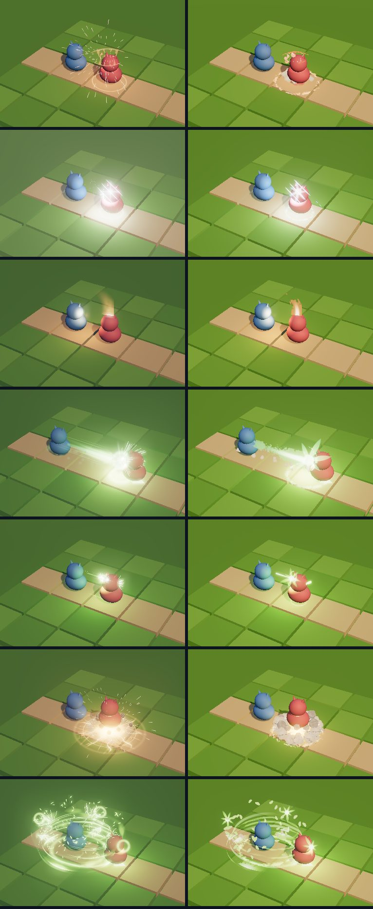
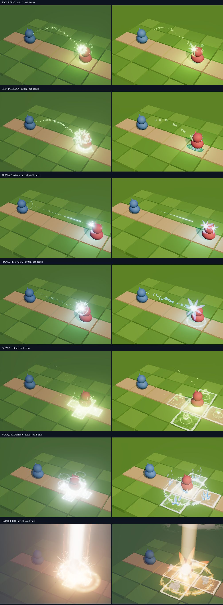
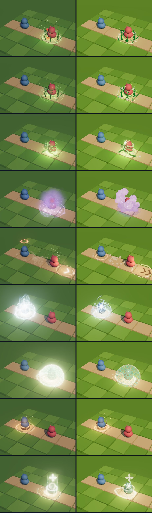
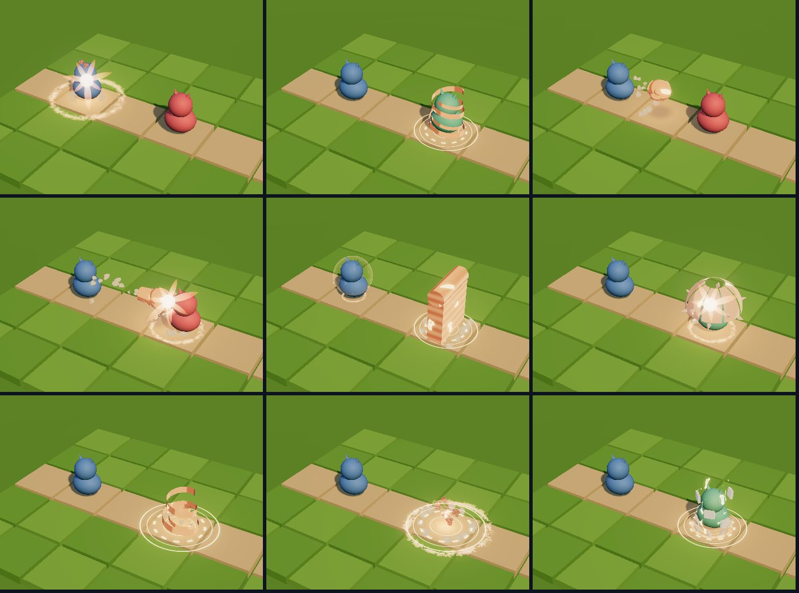
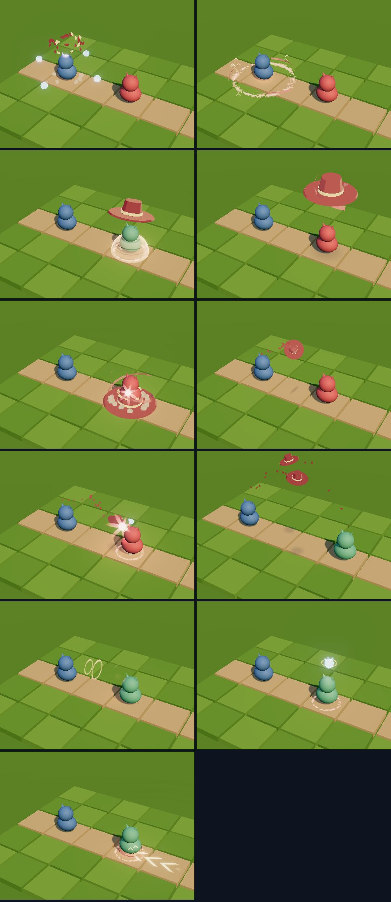
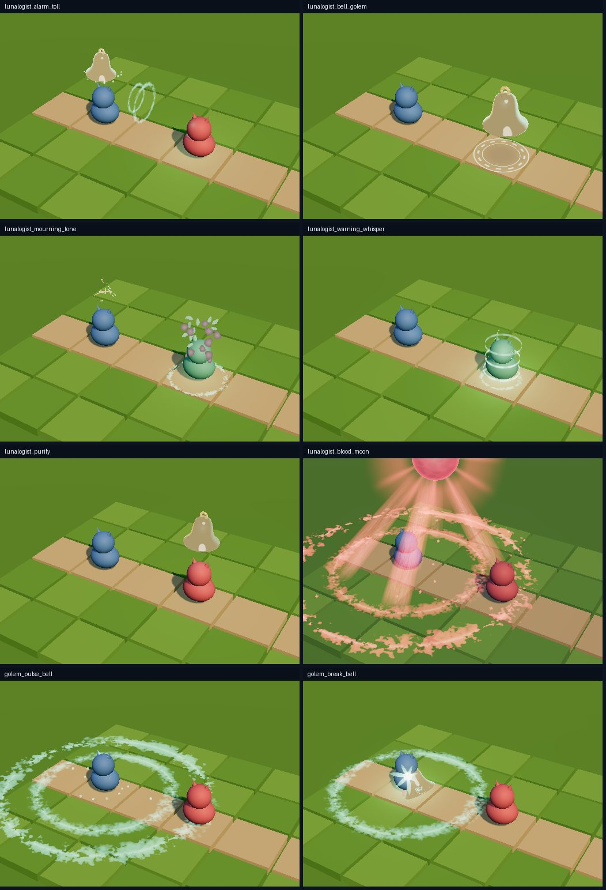
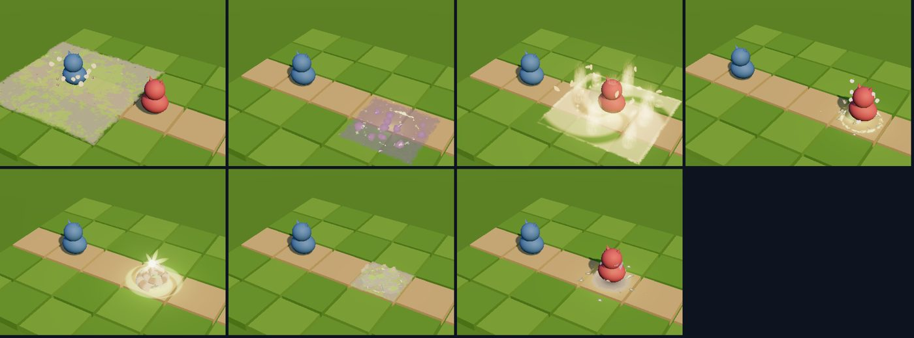

# Hito 100: VFX estilizados para los 61 ataques de enemigos, las 24 habilidades del Sapidae y los gólems

> **Estado:** en la versión de prueba (29-oct-2026). Sigue **apagado** por defecto: se enciende con `lkDebug.vfxEstilo(true)` para probarlo en combate. Cuando se dé por bueno, basta con encenderlo por defecto (sección 6).
> **Pedido:** continuar el piloto del Hito 99 («me gustan como quedaron»): pasar al estilo nuevo las 21 plantillas básicas, que cubren los 61 ataques de enemigos, y dar efecto propio a las 24 habilidades del Sapidae y a sus gólems, que hasta ahora usaban alias de las clases antiguas o un anillo plano.

## 1. Qué cubre

| Grupo | Efectos | Módulo |
|---|---|---|
| Plantillas cuerpo a cuerpo | MORDISCO (con sangrado), ZARPAZO, GOLPE, EMBESTIDA, ESTOCADA, GOLPE_SISMICO, GIRO_EMPUJE | `mod-estilizado-cuerpo.js` |
| Plantillas a distancia y área | ESCUPITAJO, BABA_PEGAJOSA, FLECHA, PROYECTIL_MAGICO, RAFAGA, NOVA_CRUZ, CATACLISMO | `mod-estilizado-distancia.js` |
| Plantillas de control y apoyo | ESPINAS, ENREDO, NUBE_ESPORAS, RUGIDO, AUTOBUFF, ESCUDO, CURA | `mod-estilizado-apoyo.js` |
| Los 61 ataques de enemigos | Misma tabla que `mod-enemigos.js` con las plantillas nuevas (clave `sty__<id>`) | `mod-estilizado-enemigos.js` |
| Alfarero de Gólems | 6 habilidades + rotura del Centinela | `mod-estilizado-sapidae-alfarero.js` |
| Comandante de Sombrero | 6 habilidades + pulso y rotura del Gólem Sombrero | `mod-estilizado-sapidae-comandante.js` |
| Guardián de Campanas | 6 habilidades + pulso y rotura del Gólem Campanario | `mod-estilizado-sapidae-guardian.js` |
| Rastreador Gogo | 6 habilidades + rotura del Gólem Caparazón | `mod-estilizado-sapidae-rastreador.js` |

En total, **114 efectos estilizados**: 21 plantillas, 61 ataques de enemigos, 24 habilidades del Sapidae, 6 efectos de gólem y los 2 del piloto (Watermelon y Esporas).

- **Plantillas:** reciben las mismas opciones que las originales (`poison`, `slow`, `burn`, `bleed`, `push`, `taunt`, `stun`, `shield`, `self`, `style: cristal | llamas | esporas | estrellas | certero | hex | corteza`, `radius`…) y conservan duración, instante de impacto, nivel y anclas. El daño llega igual.
- **Sapidae:** claves `sty_<id de la habilidad>`. Sustituyen la tabla de alias (`SAPIDAE_VFX_ALIAS`) cuando el estilo nuevo está encendido. Paleta de cada clase, sacada de sus emblemas: terracota, vino, jade y musgo.
- **Invocaciones:** el efecto acompaña la salida del gólem de la tierra (unos 0,4 s después del impacto) sin taparla.
- **Gólems:** `golem_pulse_<tipo>` al final del turno del dueño (solo el Sombrero y el Campanario tienen pulso) y `golem_break_<tipo>` al romperse.

## 2. Hojas de contacto (laboratorio, tablero con la luz del Bosque)

## 3. Cambios en el kit (`vfx-stylized.js`)

- **Piezas compartidas:** `S.hitSpark` (chispa de impacto), `S.groundRing` (anillo de pincel), `S.contactShadow` y los fragmentos `S.FS.HITSPARK`, `RING` y `CONTACT`.
- **Estados estilizados** `S.status(a, kind, who, T0, TE)`: veneno (burbujas), lento (gotas y charco), débil (chevrones), frágil (esquirlas), quemadura (llamas y chamuscado), sangrado (gotas y mancha), aturdir (estrellas en órbita) y provocar (anillo). Colores semánticos fijos, más `S.statusGlow` para el brillo del objetivo.
- **Menos blanco:** el brillo caliente de las rampas baja (`styRamp` 0,6 → 0,38; `styRampOf` 0,45 → 0,25) y la energía de las formas se apoya menos en el blanco.

## 4. Cambios en el puente (`VfxBridge.js`)

- **Enemigos:** con el estilo encendido, cualquier ataque de enemigo usa `sty__<id>` de `mod-estilizado-enemigos.js`. Si un tipo no tuviera versión nueva, se registra la original con esa clave, así nunca se queda sin efecto.
- **Sapidae:** con el estilo encendido, las 24 habilidades usan `sty_<id>` del módulo de su clase. Tienen prioridad sobre el piloto: la Espiral del Alba ya no reutiliza Esporas.
- **Gólems:** escucha `golem:pulse` y `golem:broken` (`_onGolemFx`) y reproduce su efecto sobre el gólem o su casilla. No interrumpe un efecto en curso. Los efectos de gólem se preparan al empezar el combate para cada Sapidae del equipo.
- **Zonas rígidas por efecto:** `zoneTarget` / `zoneCaster`. Las áreas en cruz y en 3×3 ya no se deforman en el pasillo.
- **Luz del núcleo:** en los efectos estilizados se multiplica por 0,8 en vez de 2,2, porque lavaba de blanco el suelo bajo el impacto.
- **`vfxPlay`:** acepta las claves nuevas: `lkDebug.vfxPlay('sty_lunalogist_blood_moon')`, `lkDebug.vfxPlay('golem_pulse_bell')`, `lkDebug.vfxPlay('sty__wolf_alpha_nova')`.

**Otros archivos:**
- `mod-enemigos.js` expone su tabla (`VFX.ENEMY_ROWS`).
- `vfx-modules.js` lista los 9 módulos estilizados, con dependencias y carga del kit.
- `SAPIDAE_VFX_ALIAS` se exporta para el laboratorio.

## 5. Laboratorio (`tools/vfx-lab/estilizado.html`)

- **Selector:** el piloto, las 24 habilidades del Sapidae, los 6 efectos de gólem y los 61 ataques de enemigos (leídos de `mod-enemigos.js`).
- **Casillas:** «Sobre sí mismo», «Casilla vacía» (invocaciones, muros, zonas) y «Variante».
- **Parámetros:** `fx=enemy:<id> | basic:<TIPO> | sapi:<id> | golem:pulse_<tipo> | golem:break_<tipo>`, `&self=1`, `&empty=1`, `&var=`.
- **Sin efecto actual:** las invocaciones y los efectos de gólem no tienen versión actual; la mitad izquierda queda vacía.

## 6. Cómo probarlo y cómo dejarlo por defecto

- **En combate:** `lkDebug.vfxEstilo(true)` (se recuerda en el navegador); `lkDebug.vfxEstilo(false)` vuelve a los efectos actuales.
- **Dejarlo por defecto** cuando se apruebe: en `VfxBridge._readStyle()`, devolver `true` si no hay preferencia guardada (`localStorage.getItem(STYLE_KEY) !== 'off'`).

## 7. Comprobado

- **Banco del laboratorio** (Chromium con WebGL por software, el `VfxBridge` real): los 114 efectos se construyen y se evalúan de 0 a su duración cada 0,05 s, en todas sus variantes, sin errores de JavaScript ni de shader, con `stylized: true` y ninguno de respaldo. El impacto cae sobre el objetivo a 1, 2 y 4 casillas: a 0,2–0,5 m en golpes y proyectiles (la cara del objetivo y su retroceso) y a 0 m en áreas.
- **Pendiente en el juego real con GPU:**
  - coste en fotogramas;
  - los 5 biomas (la Mística es oscura y el Ártico blanco);
  - la orientación de las áreas 2×2 y 3×3 con la cámara girada;
  - que el anillo de pulso antiguo del gólem (`flashPulse`) no se vea doble junto al nuevo.

## 8. Problemas conocidos

- **Ciertas paletas:** con las de Hielo y Guardián algunos núcleos siguen viéndose casi blancos; los proyectiles verdes (Veneno, Baba) contrastan poco sobre la hierba.
- **Detalles poco visibles:** las cintas finas del Comandante y las ondas del Petrasentido se leen poco desde la cámara por defecto. La estela del GOLPE es pequeña.
- **Cartas a distancia en cuerpo a cuerpo:** siguen encogiéndose al 57 % (Hito 99); se arregla al migrar las cartas.
- **Pendiente:** las 235 cartas de partes de los Axies y las 3 Ultimates siguen con el estilo actual. Las texturas del atlas siguen siendo una versión procedural.
