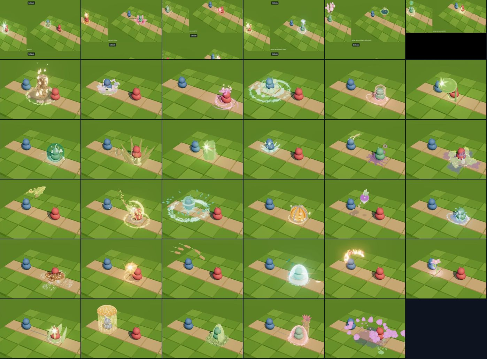
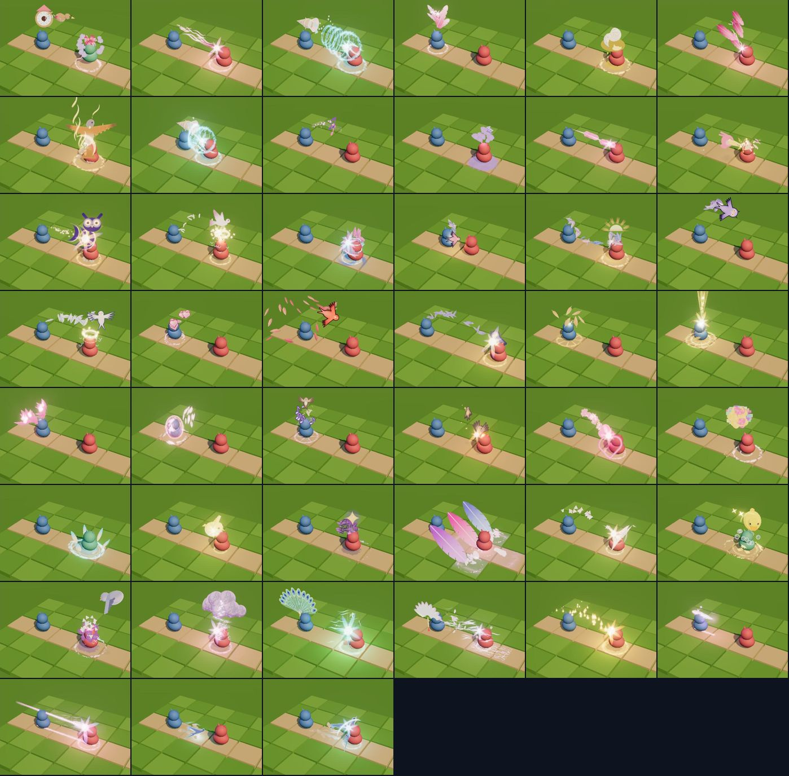
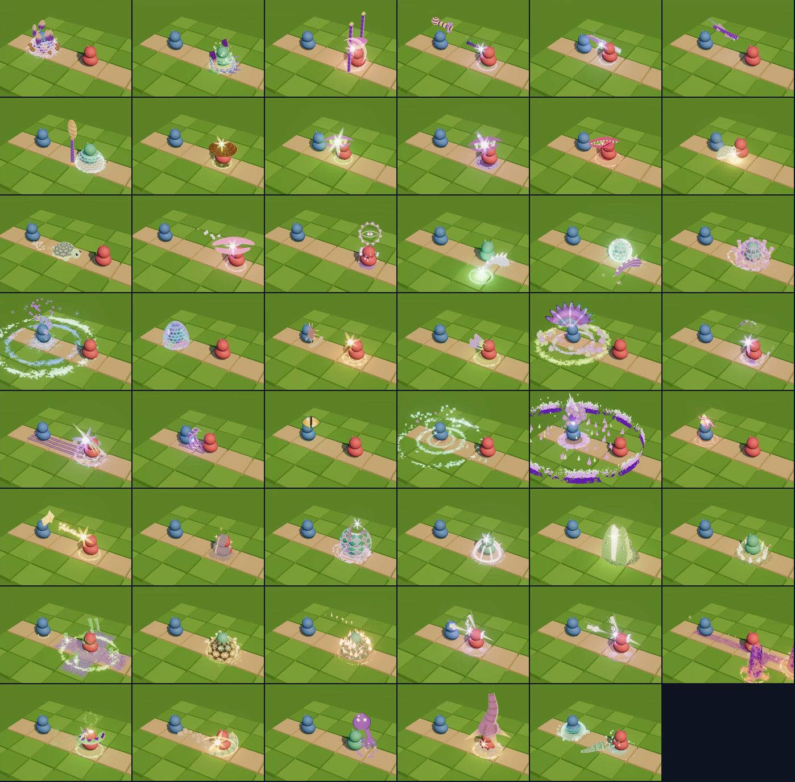
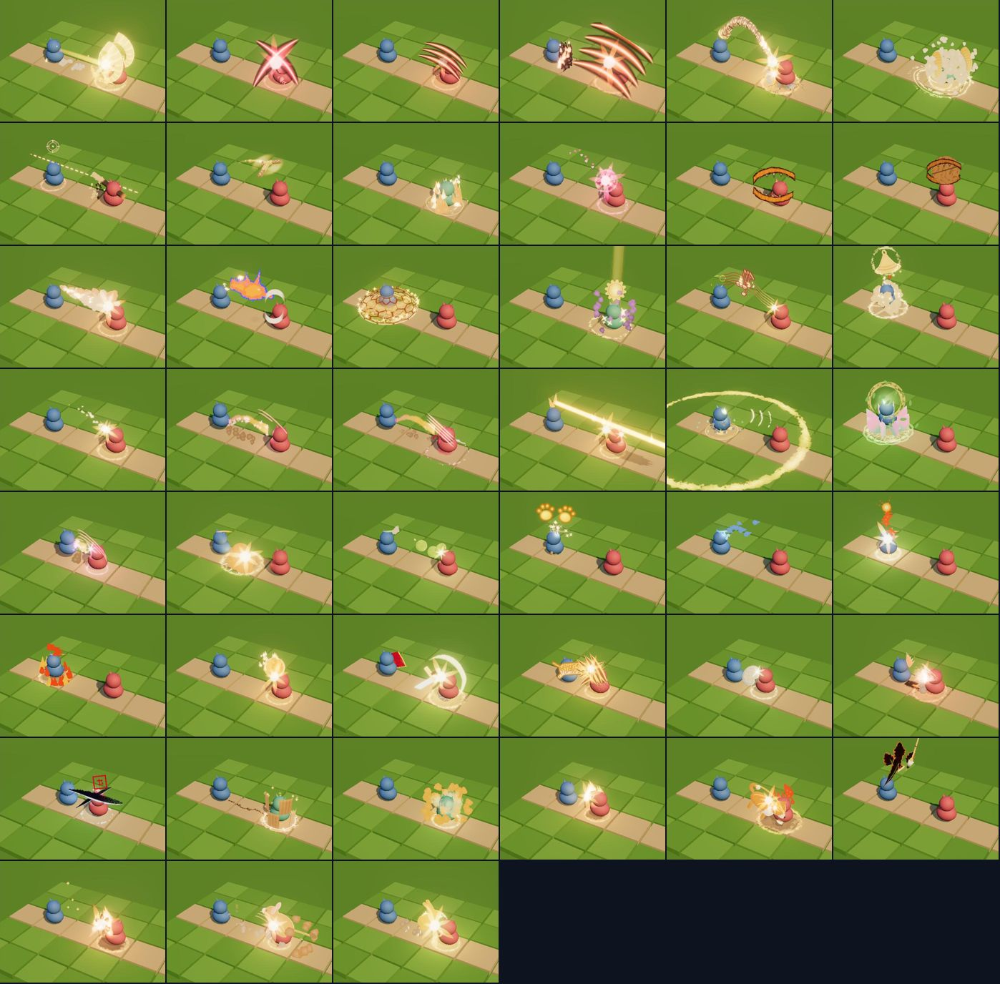
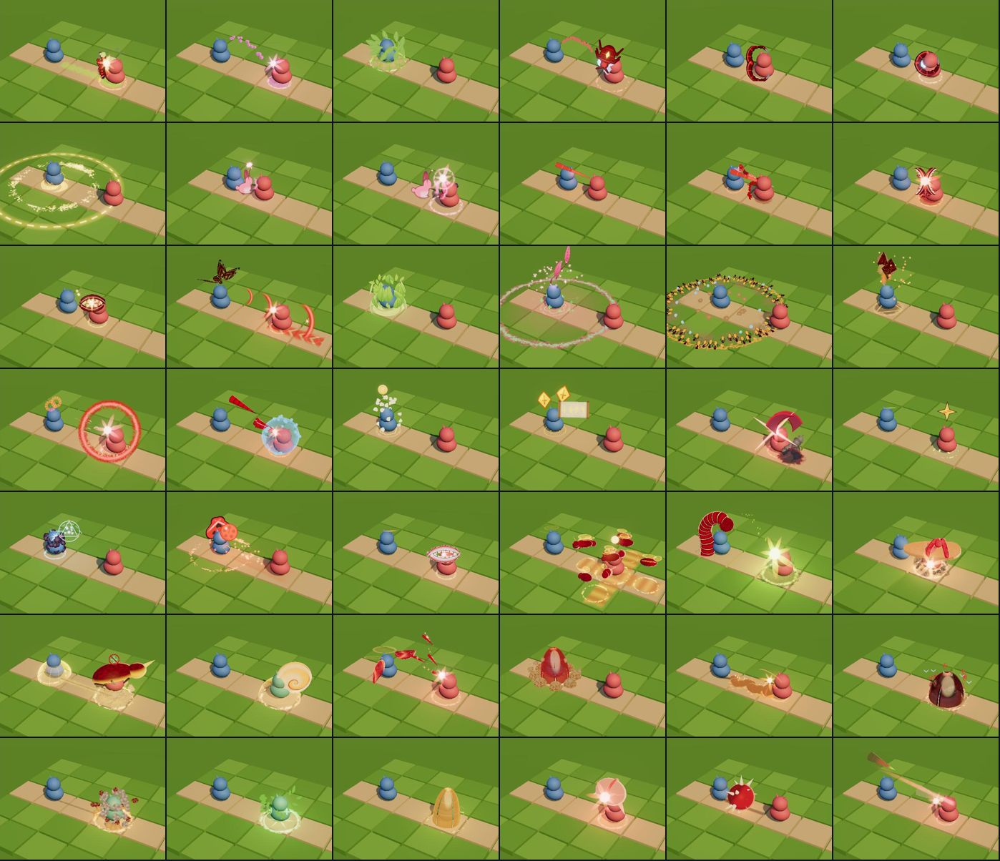
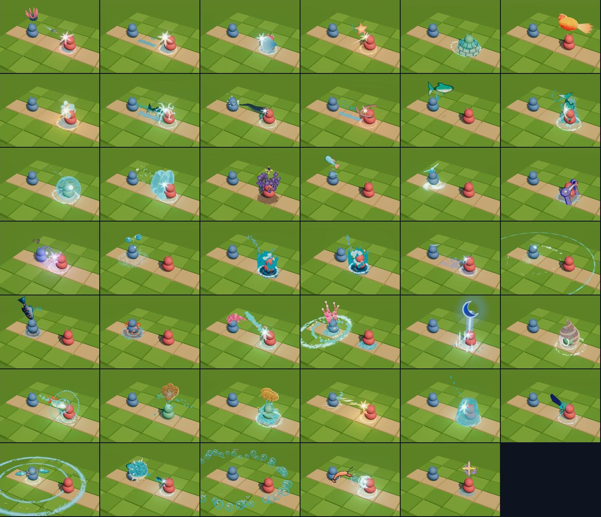
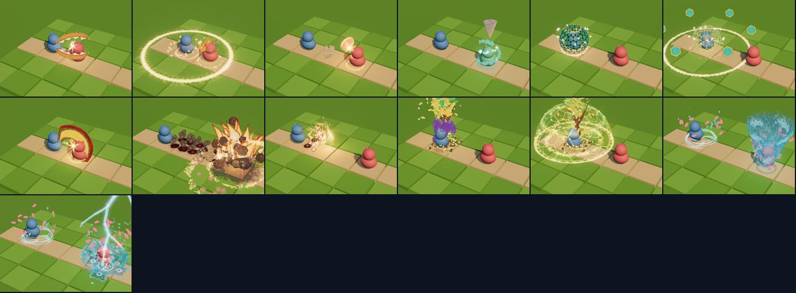

# Hito 101: VFX estilizados hechos a mano para las 235 cartas de partes, las cartas α y las Ultimates

> **Estado:** en la versión de prueba (29-oct-2026). El estilo nuevo va **encendido por defecto**; `lkDebug.vfxEstilo(false)` vuelve a los efectos anteriores (se recuerda en el navegador).
> **Pedido:** «Deja el estilo nuevo encendido por defecto, puedes continuar con el resto de cartas», con la opción «Todas a mano»: cada carta con efecto propio, no plantillas.

## 1. Qué cubre

| Grupo | Cartas | Módulos (`src/vfx/modules/`) |
|---|---|---|
| Planta | 43 | `mod-estilizado-planta-{cuernos,boca,orejas,ojos,espalda,cola}.js` |
| Pájaro | 39 | `mod-estilizado-pajaro-*.js` |
| Reptil | 38 | `mod-estilizado-reptil-*.js` |
| Bestia | 41 | `mod-estilizado-bestia-*.js` |
| Bicho | 39 | `mod-estilizado-bicho-*.js` |
| Acuático | 35 | `mod-estilizado-acuatico-*.js` |
| Cartas α de Bing y Pomodoro | 5 | `mod-estilizado-starter-bing.js`, `mod-estilizado-starter-pomodoro.js` |
| Ultimates de dúo | 3 | `mod-estilizado-duo-{embestida,gaia,maelstrom}.js` |

Las 30 cartas de colección (Japón y Navidad) y las cartas α de los demás Axies usan el efecto de su carta base, así que también salen estilizadas.

- **Claves:** cada efecto original con clave `K` tiene su versión `sty_K` en `estilizado-<módulo>`. Mismos `dur`, `ti` (el daño llega en el mismo instante), fases y variantes; nivel (`tier`) explícito.
- **Hechas a mano:** cada carta tiene su propia idea visual con el kit estilizado (materia con luz en 3 bandas, energía aditiva, erosión, atlas de formas). Las plantillas y los estados compartidos (`S.status`, `S.hitSpark`…) solo se usan como piezas.
- **Datos actuales de la carta:** cuando el efecto antiguo ya no coincidía con lo que hace la carta (`PartCards.js`), manda la carta. Ejemplos: Persimmon hace daño (antes curaba), Robin da dos picotazos, Hero hace daño y da +1 PM, Gecko cura y limpia a todo el equipo. Cada módulo lo indica en su cabecera.
- **Efectos de equipo y de campo:** ya no dependen de los muñecos fijos del laboratorio. Son ondas radiales desde el lanzador (Punky, Gecko, Chubby, Puppy, Termite, Ranchu…), así se leen igual en cualquier casilla del tablero.

## 2. Hojas de contacto (efecto estilizado en el impacto, luz del Bosque)

## 3. Dirección de arte aplicada en las revisiones

- **Nada de cartoon:** sin ojos saltones, caras ni labios. Las cartas de ojos usan destellos de mirada pequeños; las mordidas son arcos curvos con colmillos (las mandíbulas planas parecían hamburguesas); los caparazones son materia opaca con juntas y brillo, no gelatina.
- **Propiedad intelectual:** Nyan ya no es un gato sobre un arcoíris (recordaba al meme de Nyan Cat) y los peces de Nimo ya no son peces payaso naranjas con rayas blancas (recordaban a Nemo). Son espíritus de agua turquesa con brillo coral.
- **Color:** los colores fijos de los shaders se escriben en espacio lineal (si no, salen lavados); núcleos sin blanco puro; contraste sobre la hierba con bandas oscuras o acentos cálidos.
- **Cartas de los Axies jugables** (Shinji, Early Bird, Big Yak, Bing y Pomodoro) con una ronda extra cada una: Trump, Tiny Dino, Gero, Cupid, Hollow, Cactus, Shiba, Puppy, Platypus…

## 4. Cambios en el motor

- **`VfxBridge.js`**
  - `STYLE_CARD_READY`: módulos de cartas con versión estilizada. Con el estilo encendido, `effectFor` usa `sty_<clave>` de `estilizado-<módulo>`.
  - **Cartas de aliado lanzadas sobre sí mismo** (alcance 0): antes se dibujaban lejos del lanzador. Ahora, si el efecto tiene variante `propio` se usa esa; si no, el punto donde el efecto dibuja al receptor (`ab.receiver: 'target' | 'ally'`, por defecto el aliado si el efecto tiene aliados) se lleva a la casilla del lanzador, que se mueve como ese muñeco.
  - Se exportan `STARTER_VFX` y `ULTIMATE_VFX` (laboratorio). `lkDebug.vfxPlay('sty_<clave>')` encuentra el módulo estilizado de cualquier carta.
- **`vfx-modules.js`:** los módulos `estilizado-<clase>-<parte>`, `estilizado-starter-*` y `estilizado-duo-*` se cargan sin listarlos, después de las plantillas estilizadas que pueden reutilizar.
- **`vfx-core.js`:** la semilla `aSeed.x` de las partículas va estratificada (`(i + azar) / n`). Con grupos pequeños (`floor(aSeed.x*N)`: 2 orbes de PA, 3 dardos) el azar puro podía meter varias partículas en el mismo grupo y verse una sola. Afecta a todos los módulos, también a los antiguos; la distribución sigue siendo uniforme.
- **Laboratorio** (`tools/vfx-lab/estilizado.html`): grupo «Cartas» en el selector y `?fx=card:<id de carta | starter_* | duo_*>`. Con «Sobre sí mismo» y objetivo aliado se prueba una carta de aliado lanzada sobre uno mismo.

## 5. Comprobado

- **Banco del laboratorio** (Chromium con WebGL por software, el `VfxBridge` real): los 240 efectos nuevos se construyen y se evalúan de 0 a su duración cada 0,05 s, en todas sus variantes, sin errores de JavaScript ni de shader, con `stylized: true` y ninguno de respaldo.
- **Impacto:** cae sobre el objetivo a 1, 2 y 4 casillas a 0–0,5 m (la cara del objetivo y su retroceso); en áreas y cartas de aliado, a 0 m. Las cartas a distancia ya no se encogen al 57 % lanzadas cuerpo a cuerpo (zonas rígidas por efecto).
- **Pendiente en el juego real con GPU:**
  - coste en fotogramas;
  - los 5 biomas;
  - la cámara girada;
  - los Ultimates con el dúo de verdad (en el laboratorio el dúo son muñecos invisibles).

## 6. Puntos débiles conocidos

- **Se leen pequeñas** con la cámara por defecto: agujas de Cactus, Blossom, termitas, renacuajos y algunos proyectiles en vuelo (Feather Spear, Scaly Spear, aguijones).
- **Siguen algo pálidos:** el lazo de Cupid, la costra de Topaz, los cristales de Friezard y el destello de Maelstrom al caer el rayo.
- **Formas:** la anguila con la ventosa de Lam, las pinzas de Little Crab y de Pliers (cerradas parecen un anillo), el onigiri de Rice (la banda de alga no se ve), los montículos de Ant y el capullo de Larva (bastón de caramelo).
- **Datos de Bing y Pomodoro:** sus cartas α no están en `src/` de la copia de trabajo; su comportamiento se tomó de `VFX_PENDIENTES_BING_POMODORO_ENEMIGOS.md`.
- **Texturas:** las del atlas siguen siendo la versión procedural del Hito 99.
