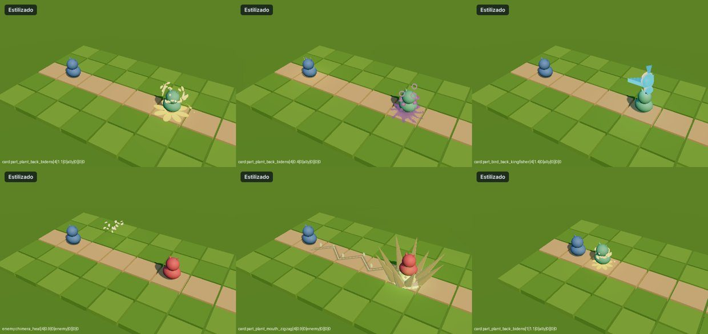
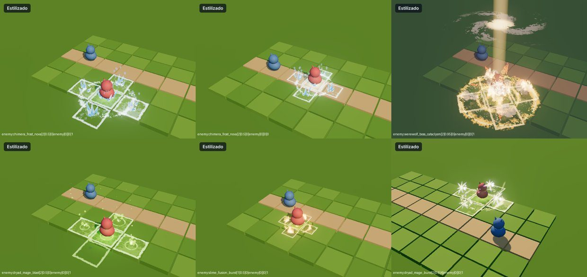
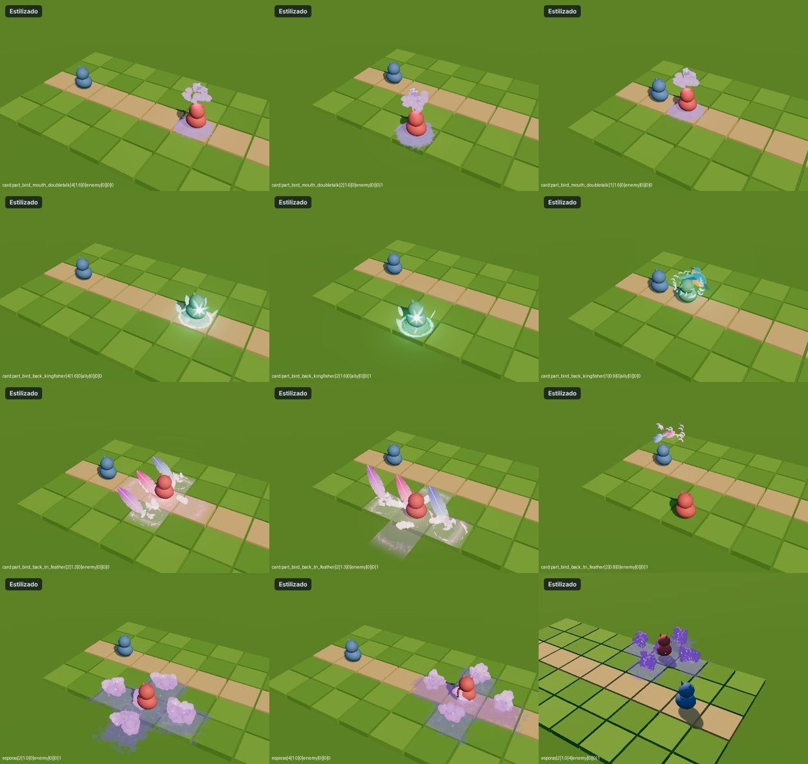
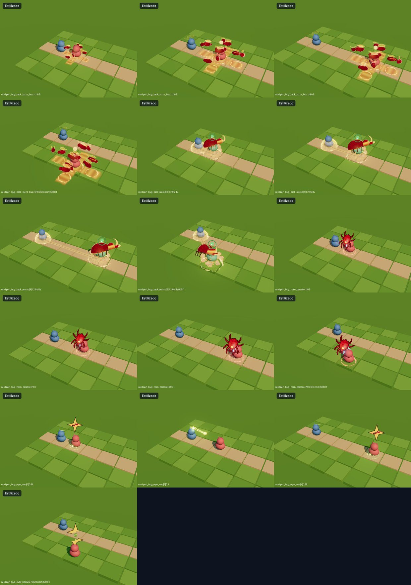
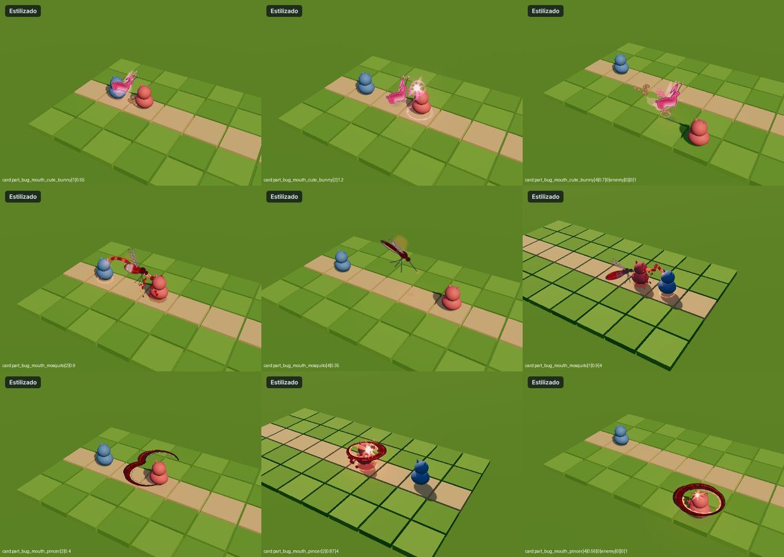
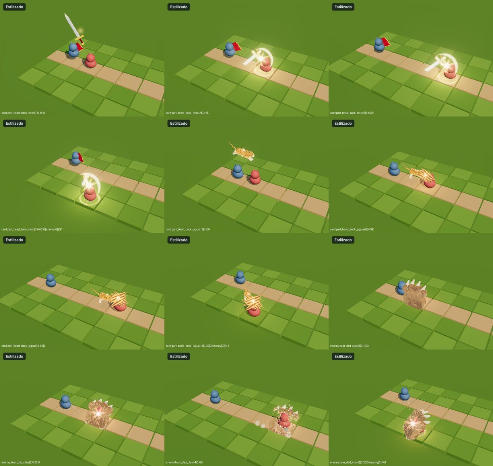
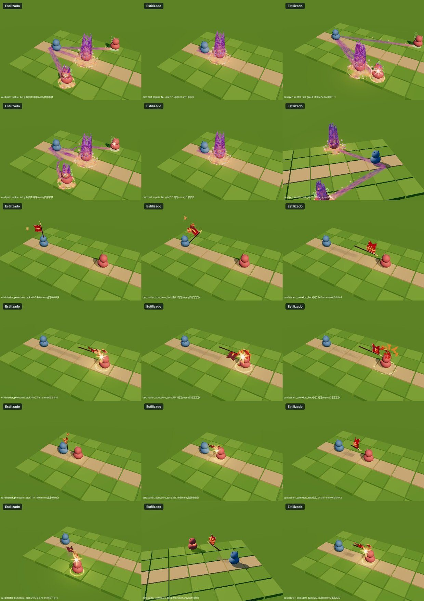
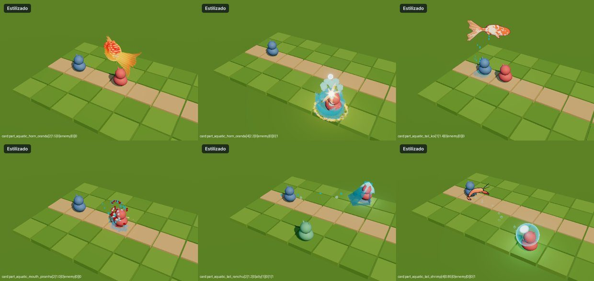
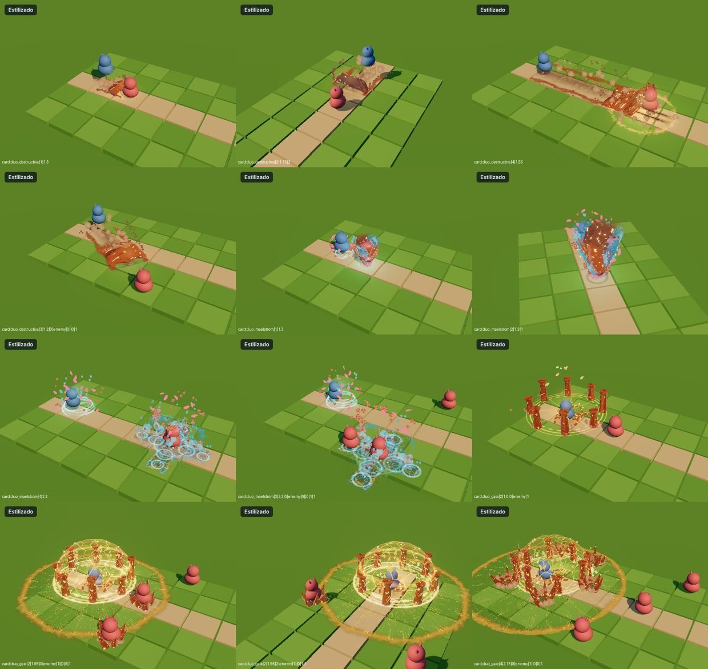

# Hito 104: Arreglos de los VFX marcados en el recorrido y Ultimates de arcilla espiritual

> **Estado:** en la versión de prueba (30-oct-2026).
> **Pedido:** la lista de 51 VFX marcados con `lkDebug.vfxRecorrido()` (Hito 102), con notas por grupo:
> - «se distorsiona el aura suelo»: el aura o el humo del suelo se estira lanzado a distancia o en diagonal;
> - «cruz»: el área en cruz se sale de la cuadrícula en diagonal;
> - «mejorar el VFX» / «cambiar VFX»: mejorar el dibujo o cambiar la idea;
> - arreglos puntuales;
> - las 3 Ultimates de dúo con tema de **arcilla espiritual**. Se mantienen las 3 y la tríada del Axie principal decide cuál sale. Cambios por Ultimate:
>   - Torrente: se queda, pero con un tornado de arcilla, agua y plumas;
>   - Asalto: cambia del todo («Ola de arcilla»);
>   - Bastión: se mejora y además hace daño (60–80 a enemigos).

**Repasar la lista:** `lkDebug.vfxRecorrido({ marcadas: true })` (nuevo) reproduce solo los efectos que marcaste con M, en su orden. Al terminar, `lkDebug.vfxMarcadasBorrar()` vacía la lista para la siguiente ronda.

## 1. Motor (`src/vfx/VfxBridge.js`, `src/vfx/vfx-stylized.js`)

### 1.1 El suelo ya no se estira
El puente adapta el efecto del laboratorio al tablero estirando el pasillo entre lanzador y objetivo. Las piezas de suelo cercanas a cada extremo se estiraban con él, sobre todo con objetivos lejanos, en diagonal o con aliados (el aliado del laboratorio está a solo ~2,9 del lanzador, así que el estirado llegaba a ~12×).

- **Zonas rígidas redondas:**
  - Todo lo que está a ras de suelo (y < ~0,5, con transición hasta 1,4) se mueve con el extremo más cercano, sin estirarse, si está dentro del radio de ese extremo:
    - objetivo: radio 2,6 (o la `zoneTarget` del efecto si es mayor);
    - lanzador: radio 1,8, con un tope del 30 % de la distancia.
  - Cada punto sigue al extremo más cercano, con transición suave.
  - Uniformes nuevos: `uVfxR` y `uVfxD`. `_warpPoint` hace la misma cuenta en la CPU.
- **Calcomanías planas:** las mallas planas, casi redondas o cuadradas y centradas se mueven enteras desde su centro (círculos, charcos, sellos).
- Las tiras largas (estelas, surcos) siguen estirándose a lo largo del pasillo, que es lo que deben hacer.

### 1.2 Áreas en cruz alineadas con la cuadrícula
- **`VFX.gridSnap`:** ángulo que devuelve las piezas de área a los ejes del tablero cuando el lanzamiento es diagonal.
- **`gridArea: 'root'`** en la definición del efecto gira el efecto entero alrededor del objetivo. Solo vale si nada sale del lanzador. Lo usan:
  - `NOVA_CRUZ` (Glacial Nova, Magma Fusion, Blizzard Fury, Glacial Spores, Cosmic Channeling);
  - Death Shroom;
  - Shiitake.
- **`S.gridAlign(obj, x, z)`** gira solo las piezas de área cuando hay un proyectil que sale del lanzador. Lo usan:
  - Ráfaga de la Espesura (las casillas de destino ahora son uniformes que se giran);
  - Tri Feather;
  - Buzz Buzz;
  - Esporas;
  - Maelstrom.

### 1.3 Posición real de las unidades
- **`VFX.foes` / `VFX.friends`:** el puente pasa al efecto los enemigos y aliados vivos del lanzador, en coordenadas del laboratorio y del más cercano al objetivo al más lejano. Cada uno lleva `{x, z, shield}`.
  - La conversión inversa (`_labOfWorld`) deshace la matriz del efecto y busca el punto por bisección sobre el estirado; vuelve al mismo punto sin error.
- **Quién lo usa:** los efectos de «todos los enemigos» (Gila, Ranchu, Égida de Gaia) y Village Hero α (emblemas solo por aliados con escudo).
  - Antes dibujaban sobre los muñecos fijos del laboratorio, que en el tablero caían en casillas vacías o en diagonal.
  - Si la lista está vacía, cada efecto usa una onda radial.

### 1.4 Laboratorio
- **`tools/vfx-lab/estilizado.html`:**
  - `&diag=1` pone el objetivo en diagonal;
  - `&extra=1` añade 2 enemigos más.

## 2. Cambios de juego

| Archivo | Cambio |
|---|---|
| `src/tactics/Spells.js` | Danza de Espinas de la Dríada (`dryad_fighter_dance`): `maxRange: 1`, ataque cuerpo a cuerpo |
| `src/tactics/combat/UltimateSystem.js` | Égida de Gaia (Bastión): primer efecto nuevo, 60–80 de daño a los enemigos del círculo de 3 casillas. Lleva `selective: true` para no herir a los aliados. Los aliados siguen recibiendo limpieza, escudo y curación |
| `src/i18n/{es,en}/spells.js` | Descripción nueva de la Égida de Gaia |

## 3. Efectos

| Efecto | Nota | Qué cambió |
|---|---|---|
| Bidens, Kingfisher, Zigzag, curación de Quimera, Titanic Bash y demás auras | Aura de suelo estirada | Arreglado en el motor (1.1) |
| Doubletalk | Segundo efecto de suelo fuera de la casilla | La niebla y el anillo son del objetivo; se desplazaban por el estirado y ahora caen justo debajo. No hay ninguna pieza en el lanzador. **Si en el juego sigue mal, márcalo otra vez con una nota de qué se ve** |
| Tri Feather | Cruz, plumas grandes | Plumas un 40 % más pequeñas; cruz, ráfaga y casillas de caída alineadas |
| Esporas, Buzz Buzz, Ráfaga, Novas, Death Shroom, Shiitake | Cruz | Alineadas (1.2) |
| Hero | Mango descentrado | La espada es ahora una sola malla centrada en la hoja (hoja, guarda, empuñadura y pomo) |
| Jaguar | Mejorar | Cuerpo 3D con luz en bandas, rosetas, cola, pose de salto y de ataque (antes, silueta plana) |
| Garra colosal (Oso Padre) | Cambiar | Clava las garras, una grieta corre hasta el objetivo y una losa de tierra con forma de zarpa se cierra sobre él; luego se desmorona. Mismos tiempos de daño |
| Scarab | Quitar el símbolo de curación, mejorar | El bloqueo de curación es una gota de savia que se seca y se agrieta, sin cruz. Escarabajo redibujado: élitros, cuerno, borde dorado |
| Parasite | Mejorar | Garrapata con placas, escudo dorado, quelíceros y 8 patas articuladas |
| Neo | Mejorar | Circuitos lima más densos, dos rayos de puntos, estrella de crítico grande que se agrieta y se parte |
| Pincer | Pinzas al revés | Dos mandíbulas planas a la altura del pecho, con bisagra del lado del lanzador, que se cierran alrededor del objetivo |
| Cute Bunny | Mejorar | Liebre espiritual sin cara con placas, antenas y saltos con recogida y aterrizaje; magenta oscuro en vez de rosa juguete |
| Mosquito | Mejorar | Mosquito de perfil con alas veteadas, probóscide que pica en el pecho y abdomen que se llena de rojo |
| Gila | Pilares en diagonal | Los géiseres salen sobre cada enemigo real (`VFX.foes`); su parte baja es translúcida para ver al enemigo dentro |
| Village Hero α | Cambiar | Pomodoro alza un estandarte y carga; por cada aliado con escudo (hasta 4) baja un emblema dorado que se suma al golpe; estocada con el asta y latigazo de tela |
| Oranda | Mejorar | Cuerpo redondo, gorro rojo, cola de velo de 3 lóbulos translúcidos y corona de agua al impactar |
| Piranha | Bocas raras al final | Las mandíbulas se separan y se deshacen en agua y sangre en 0,4 s; no queda nada |
| Koi | Cola fea | Cola de velo larga de dos lóbulos, unida al cuerpo y ondulando al nadar |
| Ranchu | Cambiar | Hincha las mejillas, vierte un chorro y una ola rueda hasta cada enemigo real y rompe sobre él; gotas violetas para Débil |
| Shrimp | Cambiar | Chasquido de gamba pistola: chorro a presión, burbuja de cavitación que implosiona en el objetivo con destello y anillo |
| Danza de Espinas (Dríada) | Forzar 1 de alcance | Cambio de juego (2) |

## 4. Ultimates de dúo: arcilla espiritual
Terracota con vetas de oro, como el Alfarero de Gólems del Sapidae. Cada una mantiene su tríada, su mecánica y el instante del daño.

- **Asalto · Embestida destructiva (nueva: «Ola de arcilla»):**
  - La arcilla se hincha bajo el dúo y sube una ola que rueda por el pasillo con los dos de pie en la cresta.
  - Deja un surco de barro con vetas de oro.
  - Rompe sobre el rival en losas, barro y chispas de oro.
  - El empujón se lee con surcos detrás del rival y una grieta de colisión.
- **Torrente · Maelstrom celeste (misma estructura):**
  - El tornado trenza cintas de arcilla con agua turquesa y plumas rosas.
  - La detonación deja barro con juntas de oro.
  - La cruz queda en la cuadrícula también en diagonal.
- **Bastión · Égida de Gaia (mejorada y con daño):**
  - 8 pilares de arcilla se alzan alrededor del dúo y una cúpula terracota y oro sella el círculo.
  - Nueva fase de **Sacudida**: una onda de barro con grietas de oro y un racimo de púas de arcilla en cada enemigo real del área.
  - Nivel 3.

## 5. Comprobado
- **Laboratorio** (Chromium con WebGL por software, el `VfxBridge` real):
  - Los 248 efectos estilizados (cartas, α, las 4 α de aliado y Garra colosal) se construyen y se evalúan sin errores, con estilo nuevo y ninguno de respaldo.
  - Los efectos arreglados caen a 0–0,35 del objetivo.
  - Las únicas medidas altas son de cartas de aliado medidas contra el enemigo, igual que antes de este hito.
- **Capturas:** cada efecto tocado a 1, 2 y 4 casillas, en diagonal, con la cámara girada y, en los de «todos los enemigos», con 2 enemigos más.

## 6. A revisar en el juego
- **Égida de Gaia:** las púas visuales salen en los enemigos a unos 5,8 del laboratorio, aproximadamente las 3 casillas del daño real. El daño lo decide `UltimateSystem`, no el efecto.
- **Garra colosal:** la losa brota del lado de la cámara para que se vea la palma. Con la cámara girada puede leerse distinto.
- **Ranchu:** las olas se leen bien de cerca, pero de lejos todavía parecen láminas.
- **Doubletalk:** ver la tabla de la sección 3.
- Pendiente con GPU, como en los hitos anteriores: coste en fotogramas y los 5 biomas.

## 7. Archivos

| Archivo | Cambio |
|---|---|
| `src/vfx/VfxBridge.js` | Suelo rígido, calcomanías planas, `gridSnap`/`gridArea`, `VFX.foes`/`friends` |
| `src/vfx/vfx-stylized.js` | `S.gridAlign` |
| `src/vfx/modules/mod-estilizado-distancia.js`, `mod-estilizado-planta-espalda.js` | Cruces alineadas |
| `src/vfx/modules/mod-estilizado-piloto.js` | Esporas alineadas |
| `src/vfx/modules/mod-estilizado-pajaro-espalda.js` | Tri Feather |
| `src/vfx/modules/mod-estilizado-bicho-{espalda,cuernos,ojos,boca}.js` | Buzz Buzz, Scarab, Parasite, Neo, Cute Bunny, Mosquito, Pincer |
| `src/vfx/modules/mod-estilizado-bestia-espalda.js` | Hero y Jaguar |
| `src/vfx/modules/mod-estilizado-enemigos.js` | Garra colosal propia (`CUSTOM`) |
| `src/vfx/modules/mod-estilizado-reptil-cola.js` | Gila |
| `src/vfx/modules/mod-estilizado-starter-pomodoro.js` | Village Hero α |
| `src/vfx/modules/mod-estilizado-acuatico-{cuernos,boca,cola}.js` | Oranda, Piranha, Koi, Ranchu, Shrimp |
| `src/vfx/modules/mod-estilizado-duo-{embestida,maelstrom,gaia}.js` | Ultimates de arcilla espiritual |
| `src/tactics/Spells.js`, `src/tactics/combat/UltimateSystem.js`, `src/i18n/{es,en}/spells.js` | Cambios de juego (sección 2) |
| `src/tactics/combat/VfxTour.js` | `vfxRecorrido({ marcadas: true })` |
| `tools/vfx-lab/estilizado.html` | `diag` y `extra` |
