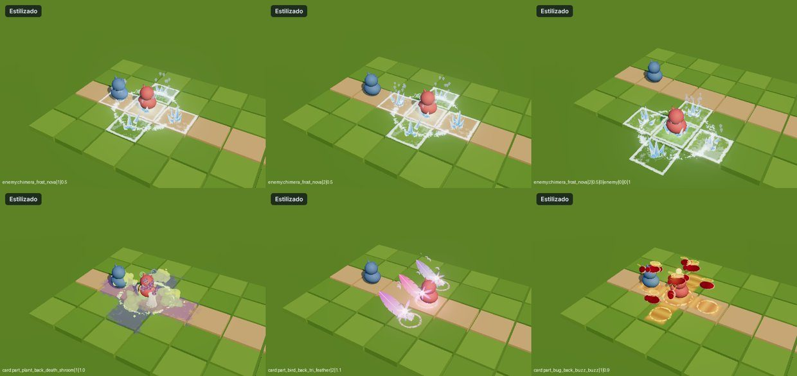
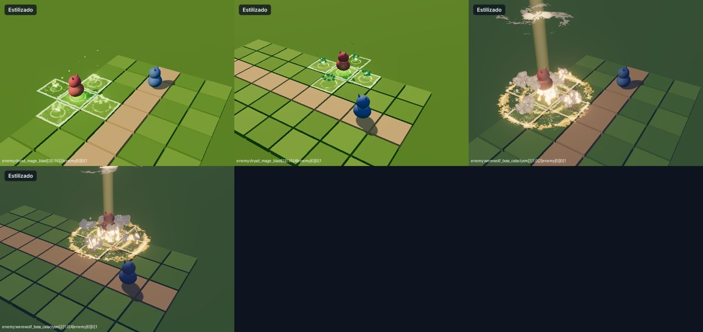
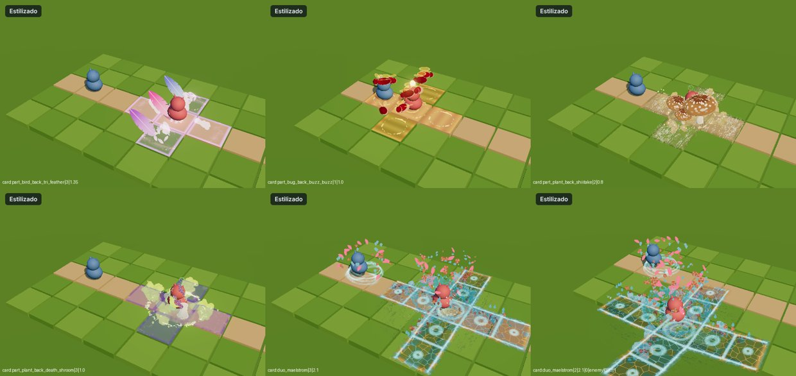

# Hito 105: Las áreas en cruz del tamaño exacto de una casilla

> **Estado:** en la versión de prueba (30-oct-2026).
> **Pedido:** «Todos los ataques en cruz tienen el VFX de cruz del suelo muy pequeño; ponlos del mismo tamaño de un cuadrado de la cuadrícula».

## 1. Causa

Había dos causas:

- **El motor encogía la cruz cerca del objetivo.** El puente deja zonas rígidas en el lanzador y en el objetivo. Cuando el objetivo está a 1–2 casillas, esas zonas no caben con el pasillo, y el puente encoge el efecto entero para que el proyectil aún recorra algo de camino. Las áreas en cruz piden una zona grande (la cruz entera), así que se encogían más que el resto:
  - a 1 casilla, al ~37 %;
  - a 2 casillas, al ~75 %;
  - a 3 o más casillas, a su tamaño real.

  Además, si el jugador cambiaba el tamaño de los VFX en las opciones, la cruz cambiaba con él y dejaba de coincidir con las casillas.
- **Algunas marcas se dibujaban más pequeñas que la casilla:**
  - **Buzz Buzz:** brazos de 0,6 casillas de ancho.
  - **Maelstrom celeste:** la cruz de 2 casillas usaba 1 unidad del laboratorio por casilla en vez de 1,93, así que salía a la mitad, con círculos pequeños.
  - **Tri Feather:** marca tenue que además crecía desde el 70 %.
  - **Shiitake y Death Shroom:** el borde de ruido se comía las esquinas.

## 2. Arreglo

### 2.1 Motor (`src/vfx/VfxBridge.js`)
- **Habilidades de área** (`areaType` cross1/cross2, circle1/2/3, box2x2/box3x3):
  - Alrededor del objetivo el efecto se dibuja **a la escala exacta de la casilla del tablero**, sin importar la distancia ni el tamaño de VFX elegido por el jugador.
  - El radio de esa zona cubre el área completa: (N + 0,6) casillas para una cruz o un círculo de radio N.
  - Lo que vuela por encima (más de ~1,5 m del laboratorio) y el resto del pasillo siguen como antes.
  - Uniforme nuevo `uVfxA` (escala de la zona; 1 si es un área). `_warpPoint` hace la misma cuenta en la CPU.
- **`_labOfWorld`:** la escala lateral ya no es la misma en todo el pasillo, así que la conversión inversa (para `VFX.foes` / `VFX.friends`) se resuelve con Newton en 3D partiendo de la bisección anterior. Las unidades caen exactas en el laboratorio a 1, 2 y 4 casillas.
- **Las cartas de una sola casilla no cambian.**

### 2.2 Efectos

| Efecto | Cambio |
|---|---|
| Buzz Buzz (`mod-estilizado-bicho-espalda.js`) | Cinco casillas enteras con relleno zumbante y borde marcado |
| Maelstrom celeste (`mod-estilizado-duo-maelstrom.js`) | Cruz de 2 casillas a escala real: charco de barro en casillas enteras con juntas, ondas por casilla, salpicaduras a lo largo de los brazos completos y rivales arrastrados hasta 2,5 casillas |
| Tri Feather (`mod-estilizado-pajaro-espalda.js`) | Casillas con borde nítido, más visibles, siempre a tamaño completo |
| Shiitake y Death Shroom (`mod-estilizado-planta-espalda.js`) | Bordes rectos por casilla; el micelio de Shiitake llena las casillas enteras |
| Ráfaga de la Espesura (`dryad_mage_blast`) | La carta es de un solo objetivo pero el efecto dibuja una cruz, así que el motor no la trataba como área y se encogía a 1–2 casillas. Los efectos pueden declarar su propia área con `areaCells` (radio en casillas): Ráfaga, Cataclismo y Esporas |
| Cataclismo (`werewolf_boss_cataclysm`) | La cruz salía en X en los lanzamientos en diagonal: no estaba marcado `gridArea:'root'`. Ahora gira con la cuadrícula |
| Novas de enemigos | Ya dibujaban casillas enteras; solo les afecta el arreglo del motor |

## 3. Comprobado
- **Laboratorio** (Chromium con WebGL por software, el `VfxBridge` real):
  - 253 efectos sin errores, con estilo nuevo y ninguno de respaldo.
  - Respecto al Hito 104 solo cambia la medida de Green Thorns (área en círculo), que ahora tiene el mismo tamaño a 1 y a 3 casillas.
- **Capturas:**
  - a 1, 2 y 3 casillas y en diagonal: Glacial Nova, Magma Fusion, Ráfaga, Cataclismo, Death Shroom, Shiitake, Tri Feather, Buzz Buzz y Maelstrom;
  - con 2 enemigos más: Gila, Ranchu y Égida de Gaia.
- **Laboratorio:** ahora pasa al puente el área de la carta, del ataque de enemigo o de la Ultimate, como en el combate.

## 4. Pendiente
- **Chimera Cataclysm** (`kibo_cataclysm`) y las habilidades en cruz de los héroes antiguos (`kotaro_*`, `bird_*`, `plant_seed_burst`, `bing_explosive`) no tienen efecto en el sistema nuevo; usan el de `SpellPresentation`.
