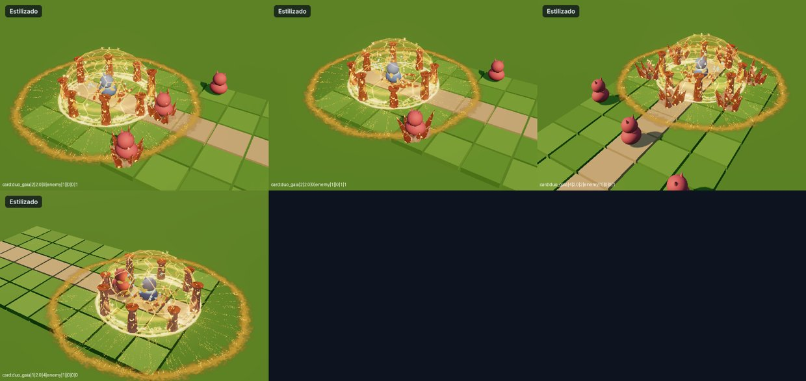

# Hito 113: La Égida de Gaia centrada en el Sapidae

> **Estado:** en la versión de prueba (2-nov-2026).
> **Pedido:** «Revisa la Ultimate de Gaia, la del escudo; quiero que salga centrada respecto al Sapidae».

## 1. Causa
`mod-estilizado-duo-gaia.js` construía todo el efecto (pulso, anillo de pilares, cúpula, lluvia, onda y estallidos de pinchos) alrededor de `C`, el **promedio del trío** Sapidae + compañero + segundo aliado. En el tablero real el compañero y el aliado quedan hacia atrás, así que la cúpula y los pilares aparecían desplazados a la izquierda/detrás del Sapidae.

## 2. Arreglo
- `C` pasa a ser la posición del Sapidae (`SP`). Cúpula, anillo de pilares, pulso, lluvia, onda y estallidos de pinchos quedan centrados en él.
- Las raíces (`M`, punto medio Sapidae–compañero) y el temblor no cambian.

## 3. Comprobado
- Laboratorio: capturas a 1, 2 y 4 casillas, en diagonal y con cámara girada, con enemigos extra: la cúpula rodea al Sapidae; los pinchos siguen saliendo en los enemigos cercanos.
- `check.cjs` de `card:duo_gaia` y `self:card:duo_gaia`: sin errores, estilo nuevo, sin respaldo.

