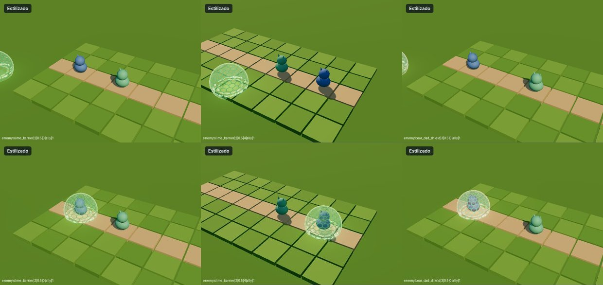

# Hito 116: Los escudos de enemigos salen sobre el lanzador

> **Estado:** en la versión de prueba (2-nov-2026).
> **Pedido:** «Gelatinous Shield, Viscous Carapace y (creo) Paternal Protection: cuando los enemigos las lanzan, el VFX se ve en una casilla vacía lejos del lanzador o del aliado».

## 1. Causa
Las tres son cartas `targetType:'ally'` de alcance 0 (la IA las lanza sobre sí misma). El puente (`VfxBridge.play`) trata una carta de aliado lanzada sobre uno mismo moviendo el punto del laboratorio donde el efecto dibuja al *receptor* hasta el lanzador. Como estos efectos no declaraban receptor, el puente tomaba el objetivo (x = 3,4), pero el escudo `self` ya se dibuja en el lanzador (x = −3,7): el efecto quedaba desplazado unos 7 unidades de laboratorio, es decir, en una casilla vacía lejos de la unidad. Thick Bark (ent) tenía el mismo fallo.
El laboratorio no lo mostraba porque pasaba esos escudos como `self`, no como `ally`.

## 2. Arreglo
- `mod-estilizado-apoyo.js`: la fábrica marca `receiver:'caster'` cuando el efecto es sobre el propio lanzador (`cfg.self`).
- `VfxBridge.js`: con `receiver:'caster'` no se remapea nada; el efecto se queda donde ya dibuja al receptor.
- Afecta a: Gelatinous Shield, Viscous Carapace, Paternal Protection y Thick Bark.

## 3. Comprobado
- Laboratorio con la carta como `ally` (como en combate), cámaras 0, 2 y 4 y distancias 1–3: el escudo rodea al lanzador (arriba: antes; abajo: ahora).
- `check.cjs` de los cuatro escudos: estilo nuevo, sin respaldo.

