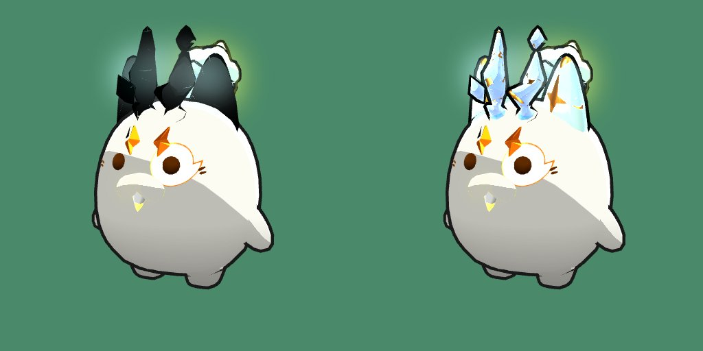

# Hito 117: Las partes místicas de nivel 1 se ven en el juego

> **Estado:** en la versión de prueba (2-nov-2026). Comprobado en un render de prueba con el three.js r160 del juego y los assets reales; falta verlo en el juego.
> **Pedido:** «las partes místicas de nivel 1 no se ven en el juego» (en el mixer de Axie sí: brillo holográfico; en Lunakai, siluetas oscuras).
> Solo se cambió una línea del mixer en `vendor/`. **No se sube `ASSET_VERSION`:** el `.htaccess` sirve los `.js` con `no-cache, must-revalidate`, así que el archivo nuevo llega en la siguiente visita sin obligar a volver a descargar modelos y audio.

## 1. Causa

- Las partes místicas de nivel 1 (`S01_<Clase>02_L1_*`, 46 en el catálogo: las 6 partes de las 6 clases, variante 02) no traen su aspecto en el modelo: el add-on de cada una (`manifest.assets.addons[...].materialOverrides.Model`) cambia el material por uno del shader `AxieMixer3D/Mystic_Final`. Las de nivel 2 usan el material normal del Axie (`S_Axie_Mixer_V4`), por eso esas sí se veían.
- El código de vértices de los materiales místicos (`MYSTIC_MESH_VERTEX_SHADER` en `vendor/axie-mixer3d/chunks/mystic-material-factory-ZyStOYbU.js`) declaraba `attribute vec2 uv1;` sin condición.
- Las mallas de nivel 1 traen un segundo juego de UV (`TEXCOORD_1`). Con eso three.js r160 define `USE_UV1` y añade su propia declaración `attribute vec2 uv1;` al principio del shader. Resultado: `ERROR: 'uv1' : redefinition`, el programa no compila y three no dibuja la superficie.
- Lo único que se veía era el contorno (`Model:ExtraPrePass`, otro material, color `_outlinecolor` oscuro) y los brillos de partículas: las siluetas oscuras.

## 2. Arreglo

`vendor/axie-mixer3d/chunks/mystic-material-factory-ZyStOYbU.js` (única declaración de `uv1` en toda la librería):

```glsl
#ifndef USE_UV1
attribute vec2 uv1;
#endif
```

Sin `USE_UV1` el shader es idéntico al de antes; con `USE_UV1` usa la declaración de three. No cambia ningún otro material (cuerpo, partes normales, nivel 2, contornos), ni el coste por fotograma.

> **Si se actualiza la librería del mixer** (`vendor/axie-mixer3d/`), conservar este cambio o comprobar que la versión nueva ya no declara `uv1` sin condición. El comentario `Lunakai Hito 117` en el shader marca el sitio. (Comentario solo en ASCII: es código GLSL.)

## 3. Comprobado

- Render de prueba en Chromium sin pantalla con `vendor/three.module.js` (r160), el `manifest.json` y los assets reales, Axie `normal` con las 6 partes `S01_Beast02_L1_*`, calidad `balanced` como en el juego:
  - antes: `'uv1' : redefinition` y 38 avisos `useProgram: program not valid`; cuernos y orejas oscuros (izquierda);
  - después: ningún error de shader; cuernos y orejas con su brillo holográfico (derecha).
- `node --check` del archivo.



## 4. Pendiente: probar en el juego

1. Cargar un Axie con partes místicas de nivel 1 (compañero, escuadrón y combate): las partes con brillo holográfico, sin siluetas oscuras.
2. Consola (F12) sin `Shader Error` ni `program not valid`.
3. Un Axie sin partes místicas y uno con partes de nivel 2: igual que antes.
