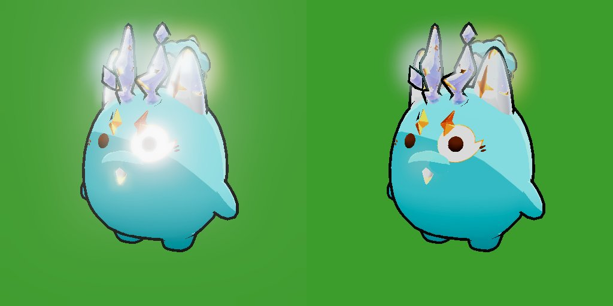

# Hito 118: Menos brillo en las partes místicas

> **Estado:** en la versión de prueba (2-nov-2026). Comprobado en un render de prueba con el three.js r160 del juego, los assets reales y el bloom del Bosque; falta verlo en el juego.
> **Pedido:** «los místicos de nivel 1 tienen un brillo o bloom bastante alto; reducirlo un poco para que se vean mejor las partes y no moleste la vista».
> Una línea en `vendor/axie-mixer3d/chunks/mystic-material-factory-ZyStOYbU.js` (el mismo archivo del Hito 117). **Sin subir `ASSET_VERSION`:** los `.js` se revalidan solos (`no-cache`).

## 1. Causa

- Los materiales místicos del mixer (`Mystic_Final` de las partes de nivel 1 y los de sus partículas) vienen de Unity, que trabaja en gamma y sin HDR: lo que pasa de blanco se recorta. Sus valores son muy altos (borde de luz `_RimColor` de hasta 238, emisión `_Emiss` 7, color en movimiento ×12) y se escriben con `toneMapped: false`.
- El juego dibuja en un destino con más rango que el blanco (EffectComposer), así que esos valores llegaban enteros al bloom. `UnrealBloomPass` deja pasar al 100 % todo lo que supera su umbral (0,82 en el Bosque, 0,86 en combate): un destello que tapaba cuernos, orejas y ojos.
- En el render de prueba, sin tope el bloom se llenaba de valores no válidos y la imagen salía negra (el mismo síntoma que el Hito 21). En el juego se veía como el destello blanco, pero el riesgo existía.
- El brillo de las partículas de los add-ons («Glow») es pequeño en comparación: casi todo el halo venía de las superficies.

## 2. Arreglo

En la salida de color común a todas las familias místicas (antes de pasar a lineal):

```glsl
// Lunakai Hito 118: cap below the game bloom threshold (...)
color = clamp(color, 0.0, 0.88);
```

- 0,88 está en espacio gamma (≈ 0,75 lineal): por debajo del umbral del bloom del mundo (0,82) y del combate (0,86). Las partes conservan su aspecto holográfico y no generan halo; queda el brillo suave de sus partículas.
- Solo afecta a materiales místicos del mixer (partes de nivel 1, sus partículas y otros efectos que usen esa fábrica). El cuerpo y las partes normales del Axie, el bloom de antorchas, faroles y VFX del juego no cambian. Sin coste por fotograma.
- **Ajuste:** subir el 0,88 da más brillo (en la prueba, desde ~0,92 vuelve el halo del ojo); bajarlo apaga las partes.

Valores comparados en la prueba: sin tope (imagen negra), 1,0 (como Unity: sigue deslumbrando porque el blanco supera el umbral), 0,92 (menos halo, el ojo aún brilla) y 0,88 (elegido).

## 3. Comprobado

- Render de prueba con `vendor/three.module.js` (r160), EffectComposer + `UnrealBloomPass` (0,80 / 0,42 / 0,82, como el Bosque), ACES con exposición 1,06; Axie `normal` color 14 con las 6 partes `S01_Beast02_L1_*`: sin errores de shader; resultado idéntico al de la opción elegida.
- `node --check` del archivo.



## 4. Pendiente: probar en el juego

1. Axie con partes místicas de nivel 1 en el Bosque (bloom más fuerte), en otra isla y en combate: las partes se ven con detalle, sin destello.
2. Un Axie normal y uno con partes de nivel 2: igual que antes.
3. Si se quiere un poco más de brillo, probar 0,90.
