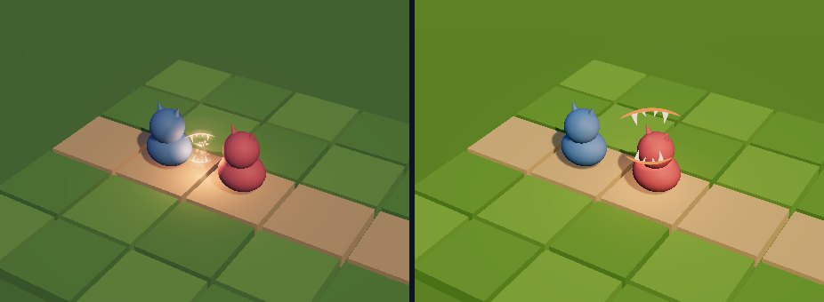
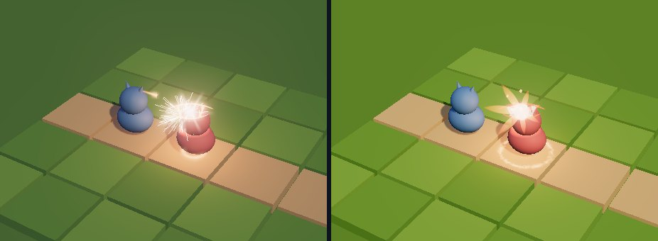
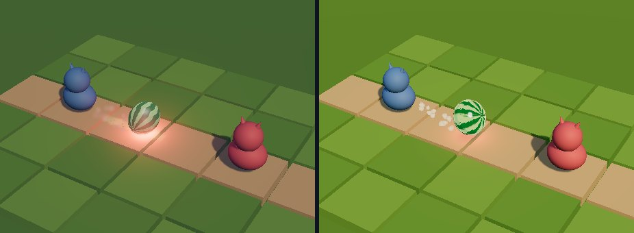
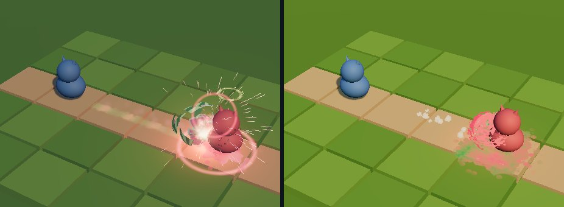
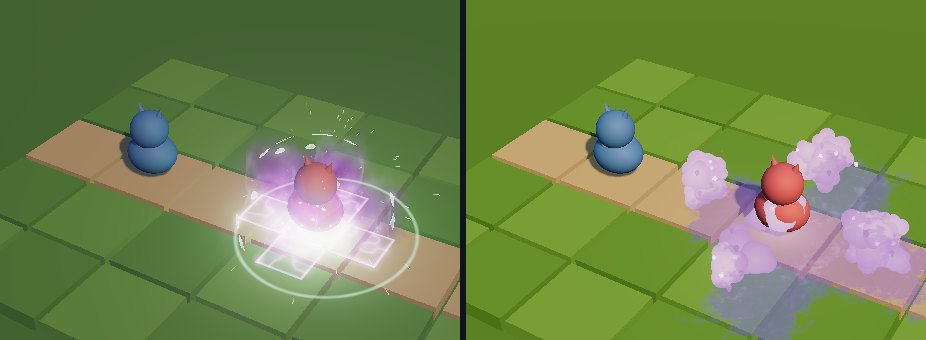
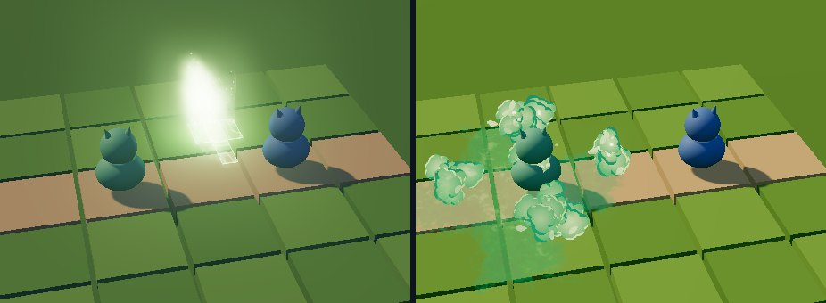

# Hito 99: VFX cuerpo a cuerpo corregidos y piloto del estilo estilizado

> **Estado:** en la versión de prueba (29-oct-2026). El arreglo del cuerpo a cuerpo está activo; el piloto estilizado está **apagado** por defecto y se enciende con `lkDebug.vfxEstilo(true)`.
> **Pedido:**
> 1. Los VFX se ven mal cuando se ataca cuerpo a cuerpo.
> 2. El estilo de los VFX no combina con el arte del juego; probar un estilo *stylized* / cel-shading sin caer en el cartoon de la prueba anterior (Hito 42, sección 8).
> **Investigación previa:** documento «Investigación: VFX estilizados para Lunakai».

## 1. Cuerpo a cuerpo: el golpe caía a mitad de camino

**Causa.** `VfxBridge` colocaba todos los efectos suponiendo los muñecos del laboratorio en −3,7 (lanzador) y 3,4 (objetivo), a 7,1 unidades. Los efectos cuerpo a cuerpo (Tajo y las fábricas `VFX.basic.MORDISCO`, `ZARPAZO`, `GOLPE`, `ESTOCADA`, `EMBESTIDA`…) se diseñaron con los muñecos juntos, por ejemplo −0,6 → 1,2. El puente llevaba el punto 3,4 al objetivo real, pero el golpe del efecto estaba en 1,2: caía antes. A una casilla, además, el pasillo encogía todo el efecto al 57 %.

**Arreglo** (`VfxBridge._anchorsOf`). Cada efecto tiene sus **anclas de diseño**. Si el módulo las declara (`anchors: { caster, target }`), se usan esas. Si no, el puente las mide evaluando la pose en t = 0 y leyendo dónde están `caster` y `target`. Esas anclas sustituyen a las fijas en `_placeRoot`, `_setWarp` y el movimiento visual de las unidades. Si la medida no tiene sentido (objetivo detrás del lanzador o fuera del eje), se usan las de siempre. Con un aliado del laboratorio (`ALLY_POS`) el lanzador sigue en −3,7.

**Medido** (laboratorio `tools/vfx-lab/estilizado.html`, puente real; distancia entre el centro del impacto `o.c` y el objetivo):

| Mordisco (`chimera_bite`) | 1 casilla | 2 casillas | 4 casillas |
|---|---|---|---|
| Antes: error | 0,80 m (al 50 % del camino), efecto al 57 % | 1,48 m (54 %) | 2,09 m (67 %) |
| Ahora: error | 0,22 m (cara del objetivo), tamaño completo | 0,22 m | 0,22 m |

Los 0,22 m restantes son el retroceso del objetivo en el instante del golpe, que el efecto dibuja delante de su cara a propósito.

*Izquierda: efecto actual con el puente de antes (`?anclas=fijas`). Derecha: el mordisco estilizado con el puente nuevo.*

**Qué efectos cambian:** de los 363 del motor, solo los 41 cuerpo a cuerpo: 7 fábricas básicas, 25 ataques de enemigos, los 7 mordiscos del piloto y 2 efectos base del laboratorio. Las 235 cartas de partes, el Sapidae y las Ultimates miden las anclas de siempre y no cambian.

**Pendiente:** una carta pensada a distancia (proyectil) lanzada a una casilla sigue encogiéndose al 57 %. Necesita una variante `melee` por efecto (saltar el vuelo); se hará al migrar cada carta al estilo nuevo.

## 2. Kit estilizado (`src/vfx/vfx-stylized.js`)

Una capa nueva junto a `vfx-lib.js`. No cambia nada de lo que existe: los módulos viejos siguen igual y los nuevos piden estos materiales. Se carga solo si hace falta un módulo estilizado (`VFX_STYLIZED_MODULES` en `vfx-modules.js`), y sus texturas terminan de cargar antes de construir y precompilar.

| Técnica | En el kit |
|---|---|
| Erosión del alfa | `styErode(m, t, s)`: las piezas se consumen desde el borde en vez de volverse transparentes |
| Rampa de color | `styRamp(x)` de 4 tonos desde la paleta (sombra fría → oscuro → claro → brillo) y `styRampOf(col, x)` para materia de un solo tono |
| Mezcla por capas | `mode: 'matter'` (mezcla normal, tapa el fondo), `'energy'` (aditiva, el núcleo pasa de 1 para el bloom), `'solid'` (opaca) |
| Sombreado en bandas | `styLight(n, L)`: 3 tonos con la luz del sol del tablero; `styTint` da el lado del sol cálido y la sombra fría (cielo) |
| Texturas pintadas | Atlas de formas y ruido tileable (abajo), en vez de ruido matemático por píxel |

- **Luz:** el puente pasa al kit la dirección y el color del `DirectionalLight` más fuerte de la escena y el color del cielo del `HemisphereLight` (`_syncStyleLight`), así cada bioma tiñe sus efectos.
- **Sin velo:** los efectos con `stylized: true` no oscurecen el tablero ni suben el bloom; se leen sobre la escena iluminada.
- **Texturas** (`src/vfx/textures/`, 570 KB en total, WEBP; se hornean con `python3 tools/vfx-lab/bake/bake_sty_textures.py`, determinista):
  - `sty-noise.webp` 512² tileable: R fbm, G celdas, B vetas en U, A ruido fino.
  - `sty-shapes.webp` 1024×512, atlas 4×2: humo, llama, hoja, esquirla, gota, chispa, corte y anillo de pincel. R = altura (silueta y relieve para la luz), G = detalle, B = ruido de la celda. El equipo de arte puede repintar cualquier celda respetando los canales.
- **API:** `VFX.sty.mat(fs, uniformes, { mode })`, `VFX.sty.pts(parent, n, vs, fs, { mode })`, fragmentos listos `MATTER_FS(celda, opciones)` y `ENERGY_FS(celda, opciones)`, `CELL`, `setLight()`.

## 3. Piloto: tres efectos (`src/vfx/modules/mod-estilizado-piloto.js`)

Los mismos tiempos de impacto (`ti`) que los originales, así que el daño llega igual.

| Efecto | Sustituye a (con el piloto encendido) | Qué tiene |
|---|---|---|
| `VFX.sty.MORDISCO` (`sty_mordisco` y `sty__<id>`) | Los 6 mordiscos de enemigos: `chimera_bite`, `wolf_aquatic_bite`, `wolf_aquatic_alpha_splash`, `wolf_gray_bite`, `wolf_alpha_bite`, `werewolf_boss_bite` (cada uno con su paleta) | Mandíbulas de marfil con encía en bandas que se cierran con estiramiento y se erosionan; chispa de púas cálida; esquirlas iluminadas; polvo de tierra a los pies; anillo de pincel |
| `sty_sandia` | Watermelon (`part_plant_horn_watermelon`) | Sandía sólida con rayas y luz en 3 tonos, brillo y sombra de contacto; polvo de rodada; reventón de pulpa que se erosiona; trozos de pulpa, pepitas y cáscara; mancha de jugo que se seca |
| `sty_esporas` (variantes `dano` / `cura`) | Esporas (`lunalogist_spores`, también la Espiral del Alba por su alias) | Vaina lanzada en parábola; 5 nubes con volumen en cruz, iluminadas por el sol; motas; gotas que caen (daño) u hojas que suben (cura); mancha en la cruz |

*En cada imagen, izquierda: efecto actual (con su velo oscuro); derecha: piloto estilizado. Mismo tablero, luz del Bosque, ACES y bloom 0,30.*

## 4. Cómo probarlo

- **Laboratorio** (sin entrar al juego): `http://localhost:8082/tools/vfx-lab/estilizado.html`. Muestra lado a lado el efecto actual y el estilizado, con distancia de 1 a 5 casillas, objetivo enemigo o aliado, velocidad, línea de tiempo y 8 posiciones de cámara. Usa el `VfxBridge` real. Parámetros: `?fx=mordisco|sandia|esporas&d=1..5&t=s&cam=0..7&team=ally`; `&solo=old|new` una sola versión; `&anclas=fijas` reproduce el puente de antes del arreglo.
- **En combate:** `lkDebug.vfxEstilo(true)` (se recuerda en el navegador), y luego:
  - `lkDebug.arena()` + `lkDebug.probar('part_plant_horn_watermelon', 1)` (o a 3 casillas);
  - para los mordiscos y las Esporas, un combate contra lobos o quimeras, o la Espiral del Alba del Rastreador Gogo;
  - `lkDebug.vfxPlay('sty_esporas')` reproduce un efecto del piloto desde la unidad activa.
  - `lkDebug.vfxEstilo(false)` vuelve a los efectos actuales; `lkDebug.vfxEstilo()` muestra el estado.

## 5. Archivos

| Archivo | Cambio |
|---|---|
| `src/vfx/VfxBridge.js` | Anclas por efecto (`_anchorsOf`); piloto estilizado (`STYLE_PILOT`, `setStylePilot`, `lkDebug.vfxEstilo`); luz del tablero para el kit; sin velo ni subida de bloom en efectos estilizados; `vfxPlay` acepta efectos del piloto |
| `src/vfx/vfx-modules.js` | Módulo `estilizado-piloto` y carga del kit (`VFX_STYLIZED_MODULES`) |
| `src/vfx/vfx-stylized.js` | Nuevo: el kit |
| `src/vfx/modules/mod-estilizado-piloto.js` | Nuevo: los 3 efectos piloto |
| `src/vfx/textures/sty-noise.webp`, `sty-shapes.webp` | Nuevas: texturas del kit |
| `tools/vfx-lab/estilizado.html` | Nuevo: laboratorio de comparación |
| `tools/vfx-lab/bake/bake_sty_textures.py` | Nuevo: horneado de las texturas |

## 6. Comprobado

- **Navegador** (Chromium con WebGL por software, el `VfxBridge` real): los 3 efectos se construyen, precompilan y dibujan en todos sus instantes, sin errores de JavaScript ni de shader.
- **Anclas:** los 363 efectos del motor se construyen con el puente nuevo; solo cambian de anclas los 41 cuerpo a cuerpo (sección 1).
- **Pendiente de probar en el juego real:** el combate con `lkDebug.vfxEstilo(true)` en una PC con GPU, en los 5 biomas (la Mística es oscura y el Ártico blanco), y el coste en fotogramas.

## 7. Siguiente

Si el piloto convence: guía de estilo corta (formas, paleta con rampa por clase, tiempos y jerarquía por PA), después las 21 fábricas `VFX.basic.*` (cubren los 61 ataques de enemigos) y las 24 habilidades del Sapidae con gólems, que hoy usan alias. Las texturas del atlas son una primera versión procedural; la calidad final pide repintarlas a mano.
